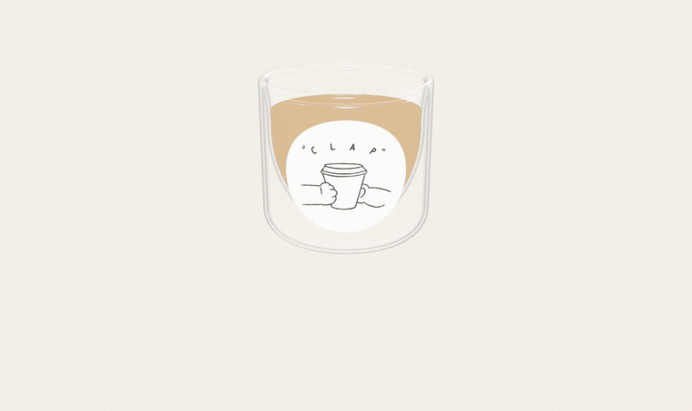
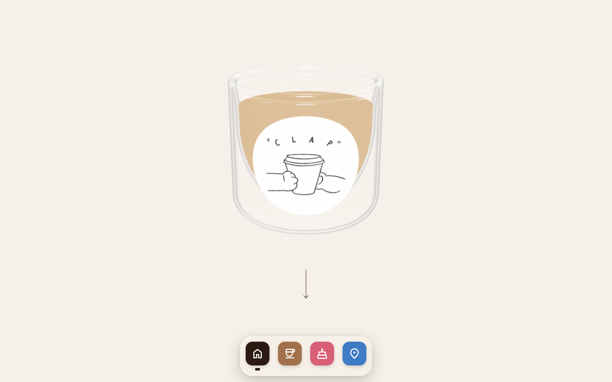
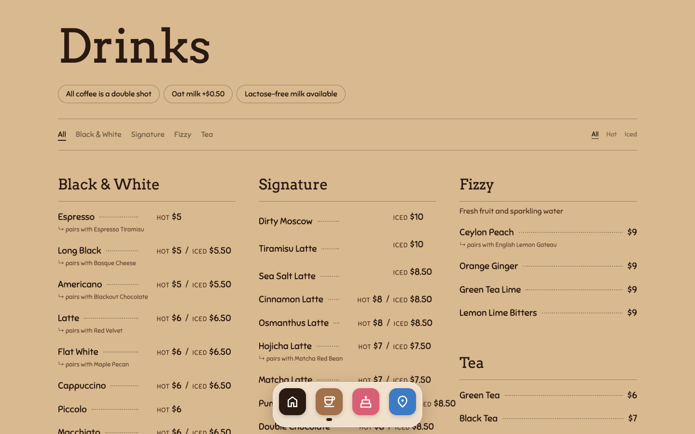
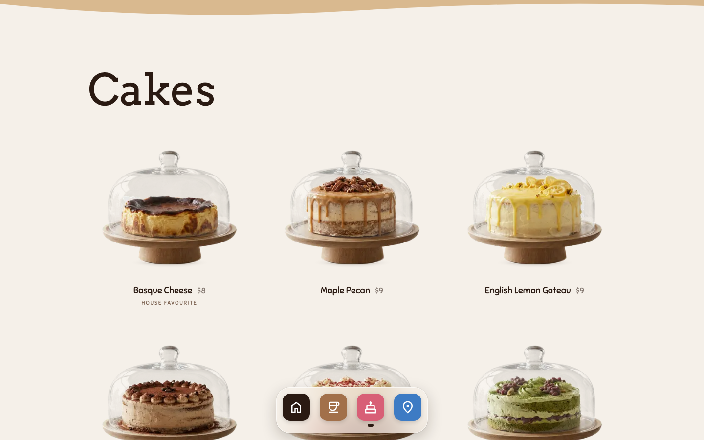
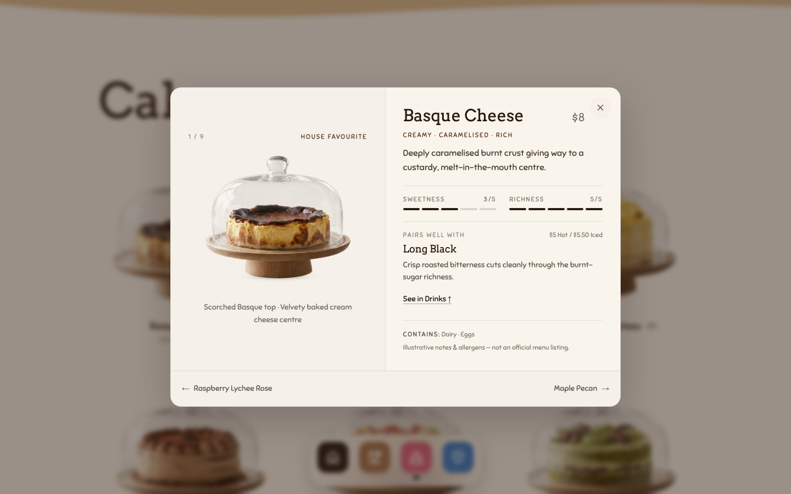
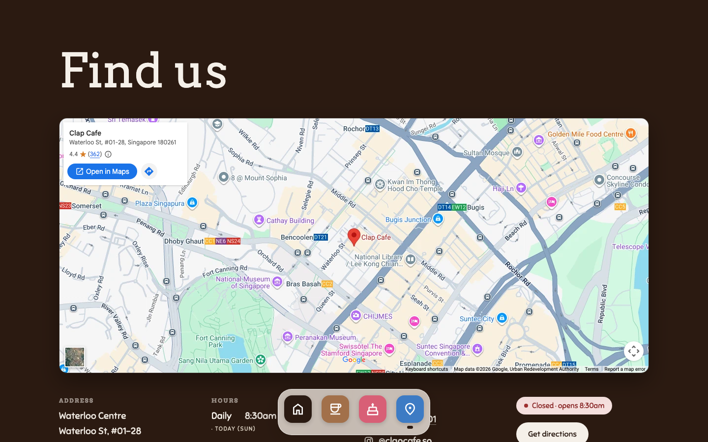
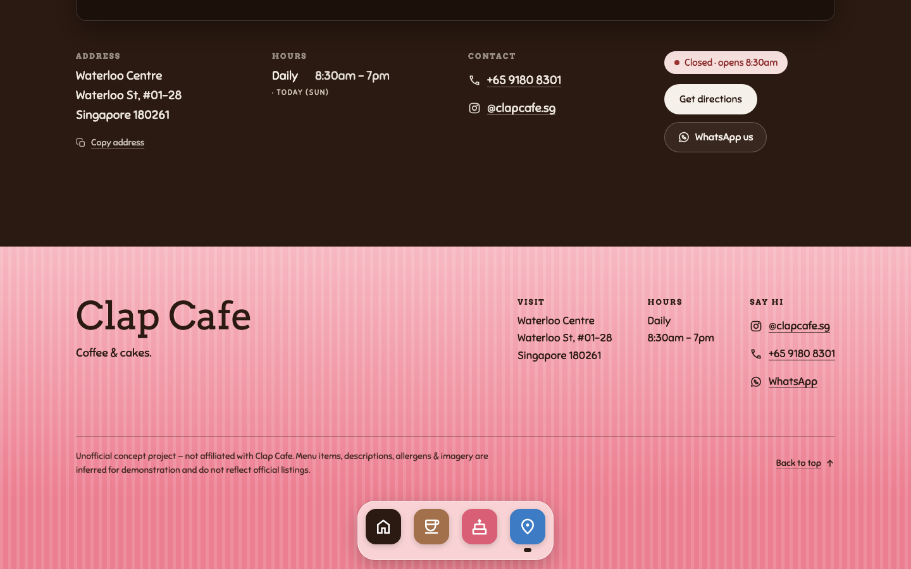

# Clap Cafe website

A one-page site for Clap Cafe (Singapore). The hero is a double-walled glass cup, modelled in
Blender, that you scroll through: it tips toward you, pours, and the latte rises to become the
drinks menu. Below that: a minimalist glass-dome Cakes gallery with interactive tasting cards,
Find us (map, hours, directions, WhatsApp) and a pink ribbed-glass footer.

Built with Next.js (App Router), React, Tailwind CSS, three.js (the 3D cup) and anime.js
(the scroll-driven pour). Read `AGENTS.md` first: this Next.js version differs from older ones.

> [!NOTE]
> **Disclaimer:** This is an independent, self-generated personal project with no affiliation, endorsement, or ties to Clap Cafe. Menu items, prices, tasting notes, allergens, and cake imagery are inferred/illustrative for demonstration only and do not reflect official listings.

## Showcase



## Section previews

| Home — 3D Glass Cup | Drinks — Filters & Pairings |
| :---: | :---: |
|  |  |

| Cakes — Studio Gallery | Cakes — Interactive Tasting Card |
| :---: | :---: |
|  |  |

| Find Us — Map, Hours & Quick Actions | Footer — Ribbed Glass & Navigation |
| :---: | :---: |
|  |  |

## Run it

```bash
npm install
npm run dev        # http://localhost:3000
npm run build      # production build
npm run start      # serve the production build
npm run lint
```

## Architecture

| File | What it does |
| --- | --- |
| `components/hero/PourStage.tsx` | The loader intro and the scroll timeline: tilt, rise, stream, wave. |
| `components/hero/cup3d.ts` | The three.js scene: loads the cup model, glass material, tilt and fill. |
| `components/hero/Cup.tsx` | The flat SVG cup, used on phones, with reduced motion, or without WebGL. |
| `components/drinks/DrinksMenu.tsx` | Category filters, Hot/Iced focus toggle, liquid drift (`Float`) and cake-pairing links. |
| `components/cakes/CakeShowcase.tsx` | Minimalist gallery of transparent glass-dome cake photos (`public/images/cakes/`). |
| `components/cakes/CakeInspector.tsx` | Accessible Tasting Card dialog with flavour notes, taste profile, allergens and drink pairing jump. |
| `components/cakes/CounterExtras.tsx` | Warm cake (with live ice cream scoop combo pricing), ice cream and sandwich menu. |
| `lib/menu-events.ts` | Lightweight CustomEvent bridge connecting Drinks and Cakes pairing links. |
| `lib/smooth-scroll.ts` | Nav and arrow scrolling, including the S-curve for the Drinks jump. |
| `components/chrome/Dock.tsx` | The bottom dock; its dot follows the section you are in. |

The 3D cup only loads on wide screens with a mouse. Everything else keeps the SVG cup.

## Rebuilding the 3D cup

The model is generated from a script, not edited by hand. With Blender installed:

```bash
/Applications/Blender.app/Contents/MacOS/Blender --background --python scripts/blender/cup.py
```

This rewrites `public/models/cup.glb` from the profile curves and the logo in
`scripts/blender/assets/`. If you change `BOWL_BOTTOM` or the liquid height in `cup.py`,
update `LIQUID_BOTTOM` / `LIQUID_TOP` in `components/hero/cup3d.ts` to match.

## Content

Menu, cakes, tasting notes, address and opening hours all live in `content/cafe-data.json`,
typed by `lib/cafe.ts`. Cake photography lives in `public/images/cakes/`. Opening hours are
read through `lib/hours/source.ts`, the one place to swap in Google Places later.
